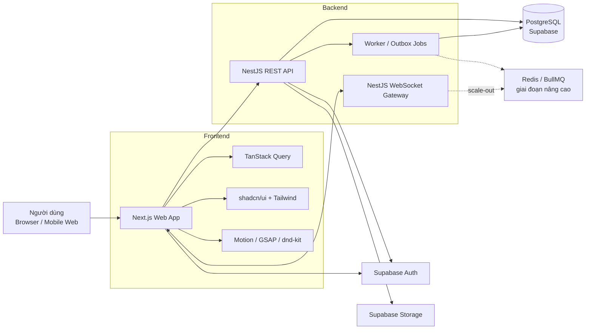
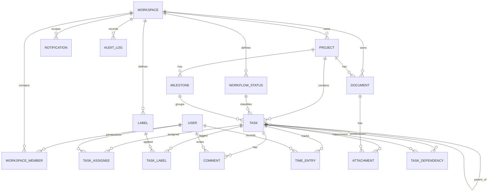
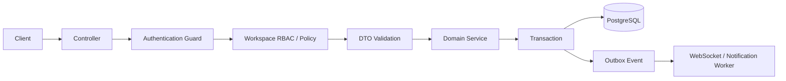
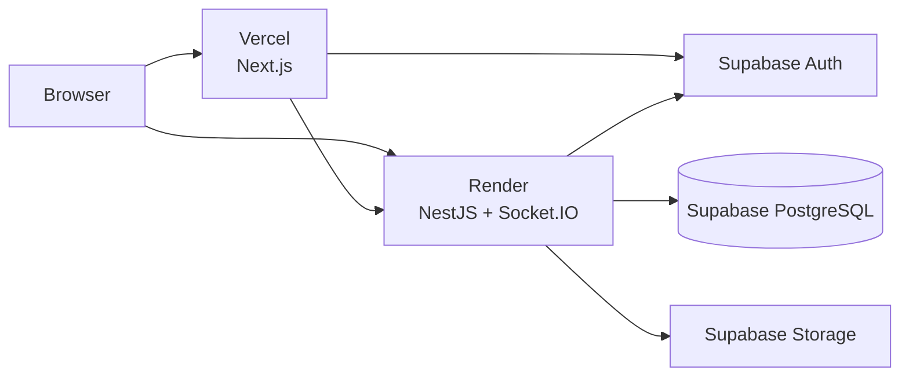

# Báo cáo nghiên cứu chuyên sâu — Hệ thống quản lý dự án và công việc

## Định vị sản phẩm, mục tiêu và phạm vi hệ thống

**Đề tài chính thức:** *Đề tài 58 — Xây dựng hệ thống quản lý dự án và công việc.*

**Bài toán cốt lõi:** xây dựng một nền tảng giúp doanh nghiệp tổ chức workspace, quản lý dự án, phân công công việc, theo dõi tiến độ và thời gian, cộng tác trên tài liệu, quản lý thành viên/phân quyền, đồng thời tổng hợp kết quả thành dashboard và báo cáo. Hệ thống nên học cách tổ chức dữ liệu linh hoạt của Notion, tốc độ và sự tập trung của Linear, độ rộng chức năng của ClickUp, tính trực quan của Trello; nhưng **không trở thành một bản sao Notion**. Đối tượng trung tâm phải luôn là `Project → Milestone → Task → Subtask`, còn tài liệu là lớp ngữ cảnh hỗ trợ dự án.

### Kết luận kiến trúc đề xuất

Sau khi đối chiếu yêu cầu đồ án, chi phí, khả năng triển khai thực tế, độ phức tạp và khả năng để Codex phát triển theo module, tôi khuyến nghị kiến trúc sau:

| Lớp | Công nghệ đề xuất | Vai trò |
|---|---|---|
| Web frontend | **Next.js + React + TypeScript** | Dashboard, workspace, views, editor, SSR shell |
| UI | **Tailwind CSS + shadcn/ui** | Design system và component nền |
| Motion | **Motion + CSS**, **GSAP** có chọn lọc | Micro-interaction và hiệu ứng cao cấp |
| Drag & drop | **dnd-kit** | Kanban, reorder, kéo task |
| Rich-text | **Tiptap** | Docs/project brief/task description |
| Server state | **TanStack Query** | Fetch/cache/invalidation/optimistic UI |
| Backend | **NestJS** | REST API, WebSocket, RBAC, nghiệp vụ |
| API contract | **OpenAPI** + typed client | Hợp đồng frontend/backend |
| ORM | **Prisma** | Schema, migration, query, transaction |
| Database | **PostgreSQL** trên **Supabase** | Dữ liệu quan hệ chính |
| Identity | **Supabase Auth** | Đăng nhập và vòng đời identity/session |
| Files | **Supabase Storage** | Attachment, avatar, tài liệu |
| Realtime | **NestJS WebSocket Gateway + Socket.IO** | Task updates, notification, presence |
| Jobs | DB outbox trước; **BullMQ + Redis** khi cần | Reminder, email, recurring task, export |
| Test | Vitest/Jest + **Playwright** | Unit, integration, E2E |
| Monorepo | **pnpm + Turborepo** | Tách web/API/shared packages |
| Triển khai demo | Vercel + Render + Supabase | Chi phí rất thấp |
| CI/CD | GitHub Actions | lint, typecheck, test, build, migrations |

Next.js hiện dùng App Router dựa trên các khả năng React hiện đại như Server Components, Suspense và Server Functions; tài liệu Next.js hiện tại cũng có hướng dẫn riêng cho authentication, data security, multi-tenant, OpenTelemetry và testing. Điều này rất phù hợp để xây dựng frontend lớn nhưng vẫn tổ chức rõ server/client boundary. citeturn14view0

Tôi **không khuyến nghị dùng Next.js làm cả frontend lẫn backend nghiệp vụ chính** cho đồ án này. NestJS riêng biệt làm kiến trúc dễ trình bày hơn khi bảo vệ: controller → guard → service → repository/database, module hóa rõ ràng, có WebSocket gateway, validation, OpenAPI, queues, caching và authorization. NestJS còn cho phép guards, pipes, interceptors và dependency injection được dùng thống nhất cả ở HTTP lẫn WebSocket gateway. citeturn19view3



Supabase phù hợp ở đây không phải vì thay backend NestJS, mà vì nó cung cấp một PostgreSQL đầy đủ cùng Auth, Storage và Realtime trong cùng hệ sinh thái; tài liệu của Supabase xác nhận mỗi project có PostgreSQL thật chứ không phải một database abstraction. citeturn16search0turn16search16

**Nguyên tắc thiết kế quan trọng nhất:** cùng một `Task` phải được chiếu ra nhiều hình thức khác nhau — List, Kanban, Calendar, Timeline/Gantt, My Work — chứ không tạo các bảng dữ liệu riêng cho mỗi view. Việc chuyển một card ở Kanban thực chất chỉ cập nhật `status`/`position`; kéo trên Calendar thay đổi ngày; resize trên Timeline thay đổi `startAt`/`dueAt`. Cách này giúp dữ liệu nhất quán, backend gọn và giải thích mô hình rất tốt khi bảo vệ.

Phạm vi nên chia thành ba tầng:

| Tầng | Mục đích |
|---|---|
| **MVP bảo vệ được** | Auth, workspace, RBAC, project, task/subtask, assignee, status, priority, labels, List/Kanban/Calendar, comment, file, dashboard, basic report |
| **Bản đồ án nổi bật** | Timeline/Gantt, time tracking, docs, realtime, notification inbox, global search, audit log, command palette, animation cao cấp |
| **Mở rộng sau đồ án** | Dependencies nâng cao, workload/capacity, automation engine, recurring tasks, baseline, custom fields, custom roles, integrations, AI assistant |

Mức phân chia này quan trọng vì một lỗi phổ biến của đề tài dạng này là cố xây “Notion + Jira + ClickUp” ngay từ đầu, làm rất nhiều màn hình nhưng không có module nào thực sự chắc chắn. Đồ án tốt hơn nên có một **vertical slice chạy hoàn chỉnh** từ UI → API → authorization → transaction → database → realtime → audit → test trước khi mở rộng.

## Nghiên cứu sản phẩm tham khảo và định hướng UI/UX

### Những gì nên học từ Notion

Notion đặc biệt đáng tham khảo ở khía cạnh **cùng một nguồn dữ liệu nhưng có nhiều database view**. Timeline của Notion là một view biểu diễn các item theo thời gian, trong khi hệ thống database còn hỗ trợ nhiều layout khác nhau; đây chính là tư duy nên áp dụng cho task data của đồ án. citeturn1search4turn1search12

Nên học:

| Ý tưởng | Cách áp dụng |
|---|---|
| Sidebar theo workspace | Workspace switcher, Favorites, My Work, Projects, Docs |
| Nội dung “page-like” | Project Overview và Docs |
| Slash command | Tiptap docs: `/heading`, `/task`, `/callout`, `/divider` |
| Context menu | `...` cho project, task, view |
| Inline editing | Click title/status/assignee để chỉnh nhanh |
| Database views | List, Board, Calendar, Timeline từ một task dataset |
| Breadcrumb | Workspace / Project / Task |
| Clean canvas | Ít border, dùng spacing và typography để phân tầng |
| Command palette | `Ctrl/Cmd + K` cho điều hướng và quick actions |
| Keyboard-first | Tạo task, chuyển trạng thái, search không cần chuột |

Điều **không nên sao chép** là biến mọi thứ thành một block database tùy ý. Quản lý dự án cần domain rõ ràng hơn: project status, assignee, milestone, deadline, dependency, time entry và permission không nên chỉ là property tự do.

Tham khảo trực tiếp: [Notion Timeline](https://www.notion.com/help/timelines). citeturn1search4

### Những gì nên học từ Linear

Linear là nguồn tham khảo quan trọng nhất cho phần “professional work management”. Tài liệu Linear tổ chức rõ issues, projects, cycles, workflows, relations/sub-issues và notifications, tức gần với domain của đề tài hơn một generic note-taking app. citeturn1search1turn1search25

Điểm nên học từ Linear là **information density nhưng không rối**: task row ngắn, shortcut mạnh, detail thường mở mà không khiến người dùng mất hoàn toàn bối cảnh của danh sách. Với đồ án, task detail nên ưu tiên **side panel/drawer** ở desktop thay vì luôn chuyển sang một trang khác.

Nên mô phỏng triết lý chứ không copy giao diện:

- tạo task cực nhanh;
- keyboard shortcut nhất quán;
- command menu;
- status/priority/assignee chỉnh inline;
- filter hoạt động như một “query builder” nhỏ;
- project overview ngắn gọn;
- transition có tốc độ nhanh hơn animation của landing page;
- optimistic UI cho những thao tác có khả năng rollback an toàn.

[Linear Docs](https://linear.app/docs) là bộ tài liệu tham khảo trực tiếp tốt nhất cho phần workflow. citeturn1search1

### Những gì nên học từ ClickUp

ClickUp đáng học ở **độ bao phủ nghiệp vụ**: quản lý task không dừng ở trạng thái mà kết nối với time tracking, reporting và nhiều cách nhìn dữ liệu. Tài liệu chính thức của ClickUp có hệ thống time tracking cho phép ghi nhận thời gian vào công việc, phù hợp trực tiếp với yêu cầu “quản lý thời gian” của đề tài. citeturn2search1

Tuy nhiên, không nên học cách nhồi mọi chức năng vào cùng một màn hình. Với đồ án này, ClickUp nên là **nguồn ý tưởng module**, còn Linear/Notion là nguồn tham khảo về độ sạch của UX.

### Những gì nên học từ Trello

Trello chứng minh một mô hình Kanban có thể cực kỳ dễ hiểu khi card, list và thao tác kéo-thả được đặt ở trung tâm. Tài liệu Atlassian cho Trello hiện bao gồm card/list, custom fields, due/start dates, checklist, attachment, comments, permissions, Calendar, Dashboard, Table, Timeline, Workspace views và automation. citeturn21view1

Timeline của Trello còn cho phép resize card để thay đổi date range và group theo list/member/label; đây là pattern rất thích hợp cho Timeline cơ bản của đồ án. citeturn21view1

Tuy vậy, không nên lưu `Board`, `Calendar`, `Timeline` thành ba loại dữ liệu khác nhau. Chúng chỉ là presentation/query configuration trên task.

Tham khảo: [Trello Timeline](https://support.atlassian.com/trello/docs/timeline-view/). citeturn21view1

### Website animation và Awwwards

Awwwards duy trì cả Site of the Day và các collection chuyên về parallax/scroll interaction; collection của họ định nghĩa parallax theo mô hình các layer foreground/background dịch chuyển ở tốc độ khác nhau để tạo chiều sâu. citeturn13search3turn13search5

Một ví dụ kỹ thuật đáng xem là các showcase sử dụng đồng thời WebGL, GSAP, 3D và scroll animation. citeturn13search25

Tham khảo trực tiếp:

- [Awwwards Site of the Day](https://www.awwwards.com/websites/sites_of_the_day/) citeturn13search3
- [Awwwards Parallax Collection](https://www.awwwards.com/awwwards/collections/parallax/) citeturn13search5
- [Awwwards Scrolling Inspiration](https://www.awwwards.com/websites/scrolling/) citeturn13search21
- [GSAP Documentation](https://gsap.com/docs/v3/)
- [Motion for React](https://motion.dev/docs/react)

**Điểm quyết định:** Awwwards nên truyền cảm hứng cho *presentation layer*, không phải productivity surface. Workspace nơi người dùng làm việc tám tiếng/ngày không nên có scroll-jacking, chữ bay liên tục, custom cursor nặng, camera WebGL hay parallax trên mọi bảng.

### Information architecture đề xuất

Desktop nên dùng mô hình ba lớp:

```text
┌─────────────────────────────────────────────────────────────────────┐
│ Topbar: Breadcrumb | Search / Command | + Create | Inbox | Profile │
├──────────────┬─────────────────────────────────────┬────────────────┤
│              │                                     │                │
│ Workspace    │            Main View                │ Task / Detail  │
│ Sidebar      │                                     │ Inspector      │
│              │ List / Board / Calendar / Timeline  │ (contextual)   │
│ Favorites    │                                     │                │
│ My Work      │                                     │                │
│ Projects     │                                     │                │
│ Docs         │                                     │                │
│ Reports      │                                     │                │
└──────────────┴─────────────────────────────────────┴────────────────┘
```

Các route chính nên được đặc tả trước khi Codex triển khai:

| Route khái niệm | Chức năng |
|---|---|
| `/home` | Personal dashboard |
| `/my-work` | Task của người hiện tại |
| `/workspace/:slug` | Workspace overview |
| `/projects` | Portfolio |
| `/projects/:id/overview` | Project summary |
| `/projects/:id/list` | Task list |
| `/projects/:id/board` | Kanban |
| `/projects/:id/calendar` | Calendar |
| `/projects/:id/timeline` | Timeline/Gantt |
| `/projects/:id/docs` | Tài liệu |
| `/docs/:id` | Document editor |
| `/reports` | Reports/dashboard |
| `/inbox` | Notifications |
| `/search` | Global search |
| `/settings/*` | Workspace/member/permission |

**Project header** không nên lặp ở từng view. Một layout dùng chung chứa icon/color, project name, status, owner, dates, progress và view switcher:

```text
Apollo Redesign    ● On Track     64%     Jan 10 → Mar 28

Overview   List   Board   Calendar   Timeline   Docs
```

**Task detail panel** nên có cấu trúc:

```text
TASK-128
Implement workspace permissions

[In Progress] [High]

Assignee       Minh
Project        Apollo
Milestone      Beta
Start          18/10
Due            22/10
Estimate       6h

Description
Subtasks
Dependencies
Attachments
Time tracking
Activity / Comments
```

Task ID dạng `PRJ-128` là một chi tiết nhỏ nhưng rất có giá trị khi demo, search, audit và thảo luận.

### Design system đề xuất

Giao diện cao cấp không đến từ việc thêm thật nhiều gradient. Nên xây design system trước animation.

| Thành phần | Quy ước |
|---|---|
| Canvas | Neutral gần trắng / gần đen |
| Accent | Một màu chính của workspace hoặc project |
| Success | trạng thái completed/on-track |
| Warning | at-risk/due soon |
| Danger | blocked/overdue |
| Typography | Geist hoặc Inter; 4–5 cấp text đủ dùng |
| Spacing | scale theo bội 4 |
| Radius | nhỏ cho input/task; vừa cho panel/card |
| Border | tinh tế, độ tương phản thấp |
| Shadow | chủ yếu cho floating UI |
| Icon | một icon set duy nhất |
| Density | Compact / Comfortable có thể mở rộng |
| Dark mode | dựa trên semantic CSS variables, không hard-code màu |

Tailwind hỗ trợ việc diễn đạt token/theme ở cấp CSS; shadcn/ui thì cung cấp component có mã nguồn nằm trong dự án, cho phép chỉnh trực tiếp. Tài liệu shadcn còn nhấn mạnh “Open Code”, composition và tính dễ đọc/chỉnh sửa bởi LLM, nên rất hợp với workflow dựa nhiều vào Codex. citeturn14view1

Các semantic token nên có dạng khái niệm:

```text
background
surface
surface-elevated
foreground
muted
border
primary
primary-foreground
success
warning
danger
focus-ring
```

Thay vì:

```text
gray-50
gray-100
purple-500
purple-600
```

Điều này giúp dark/light mode và rebranding không yêu cầu sửa hàng trăm component.

Responsive nên được thiết kế theo **capability**, không chỉ thu nhỏ desktop:

| Desktop | Tablet | Mobile |
|---|---|---|
| Sidebar cố định | Sidebar overlay | Bottom/compact navigation |
| Task side panel | Drawer | Full-screen task detail |
| Kanban nhiều cột | Horizontal scroll | Horizontal scroll |
| Full timeline | Simplified | Read-only/simplified timeline |
| Dense table | Giảm columns | Card/list representation |
| Hover actions | Hover + tap | Explicit tap actions |

## Frontend tương tác, animation và chiến lược hiệu năng

### Phân vai CSS, Motion và GSAP

Điểm quan trọng nhất là **không để ba hệ animation cạnh tranh quản lý cùng một element**.

**CSS** nên chịu trách nhiệm cho:

- color transition;
- border/background;
- focus state;
- simple opacity;
- simple transform;
- skeleton shimmer nhẹ;
- reduced-motion fallback.

**Motion** là lựa chọn chính cho application UI:

- drawer/dialog enter-exit;
- task card layout transition;
- hover/tap;
- spring;
- shared layout;
- accordion;
- toast;
- modal;
- view transition;
- drag feedback.

Motion hiện hỗ trợ hover, tap, focus, drag, enter/exit và cả scroll-triggered lẫn scroll-linked animations; tài liệu của chính Motion cũng khuyến nghị dùng CSS transition cho hiệu ứng đơn giản, tự cô lập. citeturn19view2

**GSAP** chỉ dùng khi thực sự cần timeline choreography phức tạp:

- landing/login visual;
- onboarding;
- project-created celebration;
- hero section;
- animated illustration;
- scroll storytelling;
- một số animated charts cao cấp;
- showcase/demo mode.

GSAP cung cấp core animation cùng hệ plugin cho các tình huống như scroll và dragging; ScrollTrigger/ScrollSmoother là các công cụ chuyên biệt hơn cho trải nghiệm scroll. citeturn5search8turn5search12

Quy tắc đề xuất:

> **CSS → Motion → GSAP**, chỉ tăng mức công cụ khi mức trước không giải quyết tốt vấn đề.

Không nên dùng GSAP chỉ để làm button scale từ `1` lên `1.02`.

### Motion language

Animation nên được tiêu chuẩn hóa như typography:

| Token | Khoảng đề xuất | Ứng dụng |
|---|---:|---|
| `instant` | 80–120 ms | pressed state |
| `fast` | 120–180 ms | tooltip/menu |
| `normal` | 180–260 ms | panel, tab |
| `slow` | 300–450 ms | dialog/page reveal |
| `cinematic` | 600–1200 ms | landing/onboarding |

Đây là các giá trị thiết kế đề xuất cho đồ án, không phải một chuẩn bắt buộc.

Micro-interaction tốt nên trả lời một trong ba câu hỏi:

1. “Hành động của tôi đã được nhận chưa?”
2. “Object vừa đi đâu?”
3. “Trạng thái vừa thay đổi như thế nào?”

Ví dụ:

```text
Drag task
   ↓
Card nổi nhẹ + shadow
   ↓
Drop zone mở khoảng trống
   ↓
Drop
   ↓
Layout spring về vị trí
   ↓
Status cập nhật optimistic
   ↓
Server xác nhận
```

Nếu server trả conflict:

```text
Optimistic state
     ↓
409 Conflict
     ↓
Rollback/Refetch
     ↓
Toast: "Task đã được cập nhật ở phiên khác"
```

Đây là animation có chức năng, thay vì animation trang trí.

### Drag-and-drop

dnd-kit rất phù hợp cho Kanban vì toolkit hỗ trợ drag, drop, sort và reorder, đồng thời có sensors cho mouse, touch và keyboard cùng extension points cho modifiers. Tài liệu chính thức cũng đặt performance, accessibility và reliability là mục tiêu của toolkit. citeturn19view1

Dnd nên áp dụng cho:

- reorder task trong cùng column;
- chuyển task sang status khác;
- reorder subtask;
- reorder sidebar favorites;
- schedule task vào Calendar;
- kéo/resize item trong Timeline nếu implementation cho phép.

Không nên cho phép “kéo mọi thứ ở mọi nơi”; càng nhiều draggable context thì touch interaction và accessibility càng phức tạp.

### Smooth scrolling, parallax và hiệu ứng 3D

**Không sử dụng custom smooth scrolling cho vùng workspace chính.**

Project list, Kanban, editor và task detail phải dùng native scrolling vì đó là vùng công cụ. Smooth scroll chỉ hợp với landing/onboarding hoặc một trang project presentation riêng.

Parallax nên được giới hạn ở:

- landing hero;
- login background;
- onboarding;
- empty-state premium illustration.

Không dùng parallax sau task cards hoặc trong dashboard đang chứa data visualization.

Hover 3D cũng chỉ nên được áp dụng lên một số card hero/dashboard lớn. Trên thiết bị không có fine pointer, hiệu ứng phải tự biến mất.

### Animated gradient và glass effects

Có thể tạo identity cao cấp bằng:

- gradient mesh rất chậm;
- spotlight theo cursor;
- subtle noise texture;
- radial glow;
- glass panel;
- moving border;
- gradient text có giới hạn.

Nhưng `blur`, box-shadow lớn và backdrop-filter trên nhiều element có thể tăng paint cost. Hướng dẫn hiệu năng animation của web.dev khuyến nghị ưu tiên `transform` và `opacity`, tránh animation các property kích hoạt layout hoặc paint, và dùng `will-change` có chọn lọc thay vì áp dụng hàng loạt. citeturn20view0

Một quy tắc thực dụng:

```text
20 task cards đang hiển thị
→ không cho cả 20 card chạy backdrop blur + animated gradient + glow.

1 selected card / 1 hero card
→ có thể dùng premium effect.
```

### Performance budget

Để yêu cầu “đẹp nhưng không lag” trở thành tiêu chí có thể kiểm thử, nên ghi thẳng vào đặc tả:

| Chỉ số | Mục tiêu |
|---|---:|
| LCP | ≤ 2,5 s |
| INP | ≤ 200 ms |
| CLS | ≤ 0,1 |
| Long task | hạn chế tối đa |
| Animation | tránh dropped frames nhìn thấy |
| Bundle animation | lazy-load phần không dùng ở workspace |
| Large list | virtualization khi cần |
| Images | responsive + optimized |
| WebGL | không nằm trong critical app bundle |

Các ngưỡng LCP, INP và CLS trên chính là ngưỡng “good” hiện được Core Web Vitals sử dụng và nên đo ở percentile 75. citeturn20view1

Performance test không được thực hiện chỉ một lần khi gần nộp. Chrome DevTools có Performance panel để phân tích runtime, animation và idle phases; web.dev cũng hướng dẫn kiểm tra dropped frames và layout/paint khi animation chạy. citeturn12search22turn20view0

### Accessibility và reduced motion

Hệ thống phải tôn trọng `prefers-reduced-motion`; đây là media feature chuẩn để nhận biết người dùng yêu cầu giảm chuyển động. WCAG cũng có hướng dẫn riêng về animation phát sinh từ tương tác. citeturn20view2turn20view3

Khi reduced motion bật:

```text
parallax          → disabled
cursor effects    → disabled
3D tilt           → disabled
large page slide  → fade/no motion
spring overshoot  → minimal
background motion → static
```

Drag/drop vẫn phải có lựa chọn keyboard hoặc action menu.

### Editor dạng Notion

Tiptap thích hợp hơn tự viết editor `contenteditable` vì đây là editor headless có hệ extension và cho phép tùy chỉnh node/schema; tài liệu chính thức cung cấp cả hệ extension và các tính năng cộng tác mở rộng. citeturn5search10turn5search14

MVP chỉ cần:

```text
Paragraph
Heading 1–3
Bold / Italic / Strike
Bullet list
Ordered list
Task list
Quote
Code block
Link
Divider
Image / Attachment
Mention @user
Task reference
```

Không nên cố clone toàn bộ Notion block system.

Dữ liệu editor nên lưu **structured JSON** thay vì HTML làm nguồn sự thật. Có thể tạo plain-text projection để search. HTML nếu cần export/render thì sinh từ dữ liệu có kiểm soát.

## Hệ thống chức năng, module nghiệp vụ và mô hình dữ liệu

### Cấu trúc module đầy đủ

Phạm vi chức năng nên được chia theo bounded module để cả kiến trúc lẫn Codex không trở thành một codebase CRUD khổng lồ.

| Module | Chức năng chính | Ưu tiên |
|---|---|---|
| Identity | login/logout/reset/profile | MVP |
| Workspace | create/switch/settings | MVP |
| Members | invite/remove/role | MVP |
| RBAC | role + permission guards | MVP |
| Projects | CRUD/status/dates/owner | MVP |
| Milestones | milestone + target date | Nâng cao |
| Tasks | CRUD/status/priority | MVP |
| Subtasks | hierarchy | MVP |
| Assignees | multi-assignee | MVP |
| Labels | labels/filter | MVP |
| Views | List/Kanban/Calendar | MVP |
| Timeline | timeline/Gantt | Nổi bật |
| Dependencies | blocked-by/blocks | Nâng cao |
| Time | timer/manual entry/estimate | Nổi bật |
| Docs | project docs/editor | Nổi bật |
| Comments | discussion/mentions | MVP |
| Attachments | file/image | MVP |
| Notifications | inbox/read state | Nổi bật |
| Realtime | event synchronization | Nổi bật |
| Search | global + contextual | Nổi bật |
| Reports | progress/time/overdue | MVP/Nổi bật |
| Audit | security/activity trail | Nổi bật |
| Saved Views | filter/sort/group preset | Nâng cao |
| Custom Fields | configurable fields | Mở rộng |
| Automation | trigger-condition-action | Mở rộng |
| Recurring Tasks | recurring schedule | Mở rộng |
| Integrations | calendar/webhook/import | Mở rộng |

### Project

Một project nên chứa:

```text
name
key             PRJ
description
icon / color
status
health
owner
start date
target date
progress
workspace
members
milestones
task workflow
```

`status` và `health` nên tách nhau:

```text
Status: Planned / Active / Completed / Cancelled
Health: On Track / At Risk / Off Track
```

Một project có thể Active nhưng Off Track.

### Task

Task là entity quan trọng nhất:

```text
id
humanReadableKey    APP-128
workspaceId
projectId
parentTaskId
title
description
statusId
priority
startAt
dueAt
estimateMinutes
position
version
createdBy
createdAt
updatedAt
completedAt
deletedAt
```

Quan hệ phụ:

```text
Task ──< TaskAssignee >── User
Task ──< TaskLabel >───── Label
Task ──< Comment
Task ──< Attachment
Task ──< TimeEntry
Task ──< TaskDependency
Task ──< Activity
```

### Subtask

Nên dùng self-reference:

```text
Task.parentTaskId → Task.id
```

Không tạo bảng `Subtask` riêng vì subtask về bản chất vẫn cần status, assignee, dates, comment và time tracking giống task.

Trong MVP nên giới hạn depth:

```text
Task
  └── Subtask
       └── có thể không cho tạo sâu hơn
```

Việc giới hạn depth giúp UX, query và progress calculation đơn giản hơn.

### Workflow status

Không hard-code toàn bộ workflow vào UI.

Có thể có:

```text
WorkflowStatus
- id
- workspaceId
- name
- type
- color
- position

type:
BACKLOG
TODO
IN_PROGRESS
DONE
CANCELLED
```

Tên hiển thị có thể là “Review”, “Testing”, “Doing”, nhưng backend vẫn biết loại logic chung.

### Progress calculation

Không nên cho frontend tự tính project progress vì mỗi màn hình có thể cho kết quả khác nhau.

Một cách dễ bảo vệ:

Chỉ xét **leaf task** để không double-count task cha và task con.

Nếu tất cả task có estimate:

\[
Progress = \frac{\sum completedEstimate}{\sum totalEstimate}\times100
\]

Nếu không có estimate:

\[
Progress = \frac{completedLeafTasks}{totalLeafTasks}\times100
\]

Không khuyến nghị gán tùy tiện:

```text
Todo        = 0%
In Progress = 50%
Done        = 100%
```

vì “In Progress” không có nghĩa công việc đã hoàn thành 50%.

### Dependencies và phát hiện vòng lặp

Quan hệ:

```text
TaskDependency
- predecessorTaskId
- successorTaskId
- type
```

Ví dụ:

```text
Design
   ↓ blocks
Frontend
   ↓ blocks
QA
```

Khi user thử:

```text
QA → Design
```

server phải từ chối vì hình thành cycle.

Đây là một tính năng **rất có giá trị khi bảo vệ đồ án** vì có yếu tố thuật toán thực sự. Có thể kiểm tra cycle bằng DFS trên directed graph, có độ phức tạp theo số vertex và edge của graph dự án:

\[
O(V + E)
\]

Hoặc dùng PostgreSQL recursive CTE.

### Thứ tự Kanban

Không nên lưu position là index `0,1,2,3...` rồi cập nhật toàn bộ column mỗi khi kéo.

Một giải pháp dễ thực hiện và giải thích:

```text
1000
2000
3000
4000
```

Kéo card vào giữa:

```text
2000
2500  ← new card
3000
```

Khi khoảng trống quá nhỏ, server rebalance lại column.

Move command nên gửi:

```text
taskId
targetStatusId
beforeTaskId?
afterTaskId?
expectedVersion
```

chứ không để client tự quyết position tuyệt đối.

### Time management

Nên có hai khái niệm khác nhau:

**Estimate**

```text
Task.estimateMinutes = 240
```

**Actual time**

```text
TimeEntry
- taskId
- userId
- startedAt
- endedAt
- durationMinutes
- note
- source
```

`actual` phải được tính từ TimeEntry, không ghi đè estimate.

Các report hữu ích:

```text
Estimated vs Actual
Time by Project
Time by User
Time by Week
Over-estimated tasks
Under-estimated tasks
```

Time tracking là một pattern trực tiếp xuất hiện trong các nền tảng như ClickUp. citeturn2search1

### Dashboard và báo cáo

Dashboard không nên chỉ là bốn số lớn trang trí.

**Personal dashboard**

```text
My Tasks Today
Overdue
Due This Week
Recently Viewed
My Workload
Recent Activity
```

**Project dashboard**

```text
Overall progress
Tasks by status
Completion trend
Overdue tasks
Milestone status
Estimated vs actual time
Top contributors
Recent activity
```

**Workspace dashboard**

```text
Projects by health
Active vs completed
Overdue by project
Workload by member
Time allocation
Upcoming milestones
```

Các biểu đồ có ý nghĩa nhất cho đồ án:

- donut/bar: task distribution;
- line/area: completed tasks over time;
- burn-up đơn giản;
- stacked bar: status by project;
- workload heatmap;
- estimate vs actual;
- project health cards.

### Search

Bản đầu không cần Elasticsearch.

PostgreSQL đã có full-text search; extension `pg_trgm` còn hỗ trợ đo similarity dựa trên trigram cùng các index operator để tăng tốc tìm chuỗi gần giống. citeturn15search1

Search pipeline đề xuất:

```text
Query
  │
  ├─ exact task key "APP-42"
  │
  ├─ prefix/title match
  │
  ├─ full-text match
  │
  └─ trigram fuzzy match
       ↓
Security filtering by workspace
       ↓
Rank
       ↓
Projects / Tasks / Docs / People
```

Không đưa một search engine riêng vào MVP trừ khi có dữ liệu đủ lớn để chứng minh cần thiết.

### Notification

Notification data model:

```text
Notification
- id
- workspaceId
- userId
- type
- actorId
- entityType
- entityId
- payload
- readAt
- createdAt
```

Trigger hợp lý:

```text
assigned to task
mentioned
comment on watched task
due soon
task overdue
project status changed
dependency unblocked
member invitation
```

WebSocket chỉ giúp notification xuất hiện tức thời; **database mới là source of truth**.

### Audit log khác activity log

Nên phân biệt:

**Activity Feed**

> Minh moved APP-42 from Todo to In Progress.

Phục vụ UX.

**Audit Log**

```text
actor
action
resource
before
after
IP
user-agent
timestamp
```

Phục vụ truy vết và bảo mật.

Không phải mọi activity đều cần IP/user-agent; không phải mọi audit event đều cần hiển thị trong project feed.

### Mô hình ERD cốt lõi



Danh sách bảng nên chuẩn bị cho đồ án:

```text
users / profiles
workspaces
workspace_members
workspace_invitations

projects
project_members
milestones

workflow_statuses
tasks
task_assignees
task_dependencies

labels
task_labels

comments
comment_mentions

documents
document_versions        optional
attachments

time_entries

notifications
notification_preferences

saved_views
recent_items

audit_logs
activity_events

custom_field_definitions    advanced
custom_field_values         advanced

automation_rules            advanced
automation_runs             advanced

outbox_events
```

### Index quan trọng

PostgreSQL indexes có thể tăng tốc retrieval nhưng cũng có chi phí khi ghi dữ liệu, nên cần chọn theo query thực tế thay vì index mọi cột. citeturn7search2

Các index nên được lên kế hoạch:

```text
workspace_members(workspace_id, user_id) UNIQUE

projects(workspace_id, status)

tasks(workspace_id, project_id)
tasks(project_id, status_id, position)
tasks(project_id, assignee...) qua junction
tasks(project_id, due_at)
tasks(parent_task_id)
tasks(updated_at)

task_assignees(task_id, user_id) UNIQUE
task_assignees(user_id, task_id)

notifications(user_id, read_at, created_at)

time_entries(task_id, started_at)
time_entries(user_id, started_at)

audit_logs(workspace_id, created_at)
```

Toàn bộ bảng tenant-owned nên có `workspace_id` trực tiếp hoặc một đường quan hệ bắt buộc dẫn đến workspace. Việc duplicate `workspace_id` có chủ ý trên một số bảng quan trọng có thể làm authorization query và partition/index đơn giản hơn, đổi lại backend phải đảm bảo tính nhất quán.

## Backend, API, bảo mật, realtime và triển khai

### Module architecture của NestJS

Không tổ chức backend như:

```text
controllers/
services/
entities/
```

cho toàn bộ ứng dụng.

Nên tổ chức **feature-first**:

```text
auth
users
workspaces
members
projects
milestones
tasks
comments
documents
files
time
notifications
realtime
search
reports
audit
jobs
```

Mỗi module sở hữu controller/service/policies/repository cần thiết.

Luồng request:



Điểm quan trọng để bảo vệ là **controller không chứa nghiệp vụ**.

Ví dụ `moveTask()` phải thuộc Task Service/domain service vì nó cần:

1. kiểm tra task;
2. kiểm tra workspace;
3. kiểm tra quyền;
4. kiểm tra destination status;
5. kiểm tra optimistic version;
6. tính position;
7. transaction update;
8. tạo audit event;
9. tạo outbox event;
10. trả task mới.

### REST thay vì GraphQL cho đồ án

Tôi khuyến nghị REST.

Không phải vì GraphQL kém, mà vì REST với domain này:

- dễ debug bằng browser/Postman;
- dễ tạo OpenAPI;
- dễ để Codex hiểu contract;
- authorization route rõ;
- caching/invalidation dễ lý giải;
- ít infrastructure hơn;
- đủ khả năng cho task management.

API prefix:

```text
/api/v1
```

Các nhóm endpoint:

```text
/auth/*
/me

/workspaces
/workspaces/:workspaceId
/workspaces/:workspaceId/members
/workspaces/:workspaceId/invitations

/projects
/projects/:projectId
/projects/:projectId/summary
/projects/:projectId/milestones

/tasks
/tasks/:taskId
/tasks/:taskId/move
/tasks/:taskId/assignees
/tasks/:taskId/dependencies
/tasks/:taskId/comments
/tasks/:taskId/time-entries

/documents
/files
/search
/notifications
/reports
/audit
```

List API nên hỗ trợ:

```text
page/cursor
limit
projectId
status[]
assignee[]
priority[]
label[]
dueFrom
dueTo
search
sort
group
```

Không tạo endpoint riêng như:

```text
/tasks/high-priority
/tasks/overdue
/tasks/my-tasks
/tasks/today
```

nếu cùng một query/filter model có thể diễn đạt chúng.

### Authentication và session

Khuyến nghị Supabase Auth chịu trách nhiệm cho identity/session thay vì Codex tự triển khai toàn bộ password-reset/email verification/token rotation từ đầu. Supabase hiện cung cấp Auth cùng Postgres, Storage và các API backend khác. citeturn16search0turn16search8

Luồng:

```text
User
  │
  ▼
Supabase Auth
  │
  ├─ authenticate
  └─ signed access identity
          │
          ▼
       Next.js
          │
          ▼
Authorization: Bearer ...
          │
          ▼
NestJS
  │ verify signature / issuer / expiry
  │
  ▼
workspace_members
  │
  ▼
RBAC policy
  │
  ▼
Domain operation
```

Backend **không bao giờ tin role của workspace gửi từ frontend**.

Frontend có thể gửi:

```text
workspaceId = abc
```

nhưng backend phải tự tra:

```text
workspace_member
WHERE workspace_id = abc
AND user_id = authenticatedUser
```

### RBAC

Role cơ bản:

| Permission | Owner | Admin | Manager | Member | Viewer |
|---|:---:|:---:|:---:|:---:|:---:|
| Workspace settings | ✓ | ✓ |  |  |  |
| Delete workspace | ✓ |  |  |  |  |
| Manage members | ✓ | ✓ |  |  |  |
| Create project | ✓ | ✓ | ✓ | tùy policy |  |
| Edit project | ✓ | ✓ | ✓ | hạn chế |  |
| Delete project | ✓ | ✓ | ✓ |  |  |
| Create task | ✓ | ✓ | ✓ | ✓ |  |
| Edit task | ✓ | ✓ | ✓ | ✓ |  |
| Assign users | ✓ | ✓ | ✓ | hạn chế |  |
| Delete task | ✓ | ✓ | ✓ | tùy policy |  |
| Log time | ✓ | ✓ | ✓ | ✓ |  |
| View reports | ✓ | ✓ | ✓ | ✓ | ✓ |
| View audit | ✓ | ✓ |  |  |  |

Code không nên rải:

```text
if role === "ADMIN"
```

khắp controller.

Nên có permission abstraction:

```text
workspace.manage
member.manage
project.create
project.update
project.delete
task.create
task.update
task.assign
task.delete
report.view
audit.view
```

Sau đó:

```text
Role → Set<Permission>
```

Custom roles có thể thêm sau mà không phải viết lại controller.

### Multi-tenancy và chống IDOR

Một lỗi backend cực kỳ dễ bị giảng viên hỏi:

> Người dùng Workspace A biết UUID task của Workspace B thì sao?

Không được:

```text
findTaskById(taskId)
```

rồi trả kết quả.

Phải query trong tenant context:

```text
task.id = taskId
AND task.workspaceId = currentWorkspaceId
```

và workspace membership đã được xác thực.

Đây là defence-in-depth quan trọng hơn việc “ẩn button” ở frontend.

### Supabase RLS

Supabase tài liệu hóa Row Level Security và khuyến nghị bật RLS cho các table nằm trong schema được expose qua Data API; policies hoạt động như điều kiện lọc ngầm trên row. citeturn14view5

Với kiến trúc này, cách sạch nhất là:

```text
Browser
  X không query application tables trực tiếp

Browser → NestJS → Prisma → PostgreSQL
```

Application tables có thể đặt trong schema server-only/không expose trực tiếp. Nếu có table nào được client truy cập qua Supabase API, table đó phải có RLS phù hợp.

**Không dựa vào RLS để thay thế NestJS authorization.**

### Validation

Mọi write request phải validate:

```text
type
length
enum
UUID
date range
business constraints
```

Ví dụ:

```text
startAt <= dueAt
estimate >= 0
assignee thuộc workspace
status thuộc workspace/project workflow
parent task cùng project
dependency khác chính task
attachment size/type hợp lệ
```

Validation chia hai lớp:

```text
DTO validation:
"priority phải thuộc enum"

Domain validation:
"assignee phải là thành viên của workspace"
```

### Transaction

Các nghiệp vụ nhiều bước phải atomic.

Ví dụ assign task:

```text
update task
insert task_assignee
insert activity
insert audit/outbox
```

Nếu bước cuối thất bại, không nên để database rơi vào trạng thái nửa hoàn thành.

Prisma hiện cung cấp transaction abstraction trong đó các write cùng transaction commit cùng nhau hoặc rollback cùng nhau. citeturn19view0

PostgreSQL còn cung cấp explicit locking cho trường hợp MVCC thông thường chưa đủ để xử lý các cuộc đua cập nhật phức tạp. citeturn7search11

### Optimistic concurrency

Task nên có:

```text
version INT
```

Client đọc:

```text
APP-42 version = 17
```

Update gửi:

```text
expectedVersion = 17
```

Server:

```text
UPDATE ...
WHERE id = ?
AND version = 17
```

Nếu zero rows:

```text
409 Conflict
```

Frontend refetch và hiển thị:

> Công việc này vừa được cập nhật ở phiên khác.

Đây là giải pháp rất thuyết phục khi giảng viên hỏi “hai người kéo cùng một task thì sao?”.

### Realtime

NestJS gateway hỗ trợ Socket.IO hoặc `ws`, đồng thời dùng được guards, pipes, interceptors và dependency injection tương tự HTTP. citeturn19view3

Room structure:

```text
user:{userId}
workspace:{workspaceId}
project:{projectId}
task:{taskId}
```

Event:

```text
task.created
task.updated
task.moved
task.deleted

comment.created

notification.created

project.updated

member.presence
```

**Không gửi toàn bộ database record tùy tiện qua WebSocket.**

Payload versioned:

```text
eventId
eventType
workspaceId
entityId
version
occurredAt
data
```

WebSocket là **signal**, không phải source of truth.

Luồng an toàn:

```text
Client A PATCH task
      ↓
DB commit thành công
      ↓
Outbox/event
      ↓
Socket "task.updated"
      ↓
Client B invalidate query
      ↓
Fetch authoritative data
```

Cách này tránh việc socket báo thành công trong khi transaction database thực tế rollback.

### Transactional outbox

Một pattern rất đáng đưa vào bản thiết kế:

```text
BEGIN

UPDATE task ...
INSERT INTO outbox_event ...

COMMIT
```

Worker sau đó:

```text
outbox
  ├─ emit WebSocket
  ├─ create notification
  └─ email if required
```

MVP có thể xử lý outbox bằng worker đơn giản đọc PostgreSQL. Khi hệ thống lớn hơn, BullMQ/Redis có thể chịu trách nhiệm cho scheduled/background jobs. NestJS có tài liệu chính thức riêng cho queue processing. citeturn6view3

Các job phù hợp:

```text
due-soon reminders
overdue reminders
recurring task creation
email notifications
report export
thumbnail processing
cleanup expired files
daily project-health snapshot
```

### File upload

Không nên:

```text
Browser → Nest → load 100 MB vào memory → Storage
```

Luồng tốt hơn:

```text
Browser
  │ request upload permission
  ▼
NestJS
  │ validate RBAC/type/size
  ▼
signed upload target
  │
  ▼
Browser ─────────────→ Supabase Storage
                         │
                         ▼
                   finalize metadata
```

Supabase Storage được tích hợp với database và access policies của Supabase. citeturn8view3turn16search8

Trong DB chỉ lưu metadata:

```text
storageKey
originalName
mimeType
size
uploadedBy
workspaceId
taskId/documentId
```

### Search, caching và query performance

Thứ tự tối ưu hợp lý:

```text
Correct query
    ↓
Indexes
    ↓
Pagination
    ↓
Avoid N+1
    ↓
Query aggregation
    ↓
Client cache
    ↓
Server/Redis cache nếu thật sự cần
```

Không đưa Redis vào chỉ để nói “có caching”.

MVP có thể dùng:

- TanStack Query client cache;
- PostgreSQL indexes;
- short-lived report cache trong memory nếu chỉ một instance;
- không cache dữ liệu permission-sensitive nếu invalidation chưa chắc chắn.

Redis trở nên hợp lý khi:

- API nhiều instance;
- Socket.IO cần adapter;
- BullMQ;
- distributed rate limiting;
- expensive report caching.

### Security baseline

OWASP ASVS hiện có phiên bản 5 và được thiết kế như một nền tảng để xác minh các security controls của web application, nên có thể dùng làm checklist bảo mật cho đồ án. citeturn7search17

Checklist bắt buộc:

| Rủi ro | Kiểm soát |
|---|---|
| Broken access control | Server-side RBAC + workspace scope |
| IDOR | `id + workspaceId` checks |
| SQL injection | ORM/parameterized query |
| XSS | structured rich text + sanitize rendering |
| CSRF | auth strategy phù hợp + SameSite/CSRF nếu cookie |
| Token leakage | không log token/secrets |
| Service key leak | không bao giờ ship service role key |
| Malicious file | allowlist type/size; private bucket |
| Mass assignment | DTO allowlist |
| Brute force | rate limits |
| Excessive data | explicit response DTO |
| Sensitive logs | redact secrets/token |
| Dependency risk | lockfile + automated audit/update review |
| Tenant leakage | integration security tests |
| Privilege escalation | permission tests |
| Realtime bypass | authorize WebSocket handshake + room joins |

CORS phải allowlist frontend origin trong production thay vì `*`.

CSP đặc biệt quan trọng do UI sử dụng editor, animation và nhiều client scripts.

### API response và errors

Nên thống nhất:

```json
{
  "error": {
    "code": "TASK_VERSION_CONFLICT",
    "message": "Task was updated by another user",
    "requestId": "..."
  }
}
```

Các error code nghiệp vụ có thể gồm:

```text
WORKSPACE_ACCESS_DENIED
PROJECT_NOT_FOUND
TASK_NOT_FOUND
TASK_VERSION_CONFLICT
INVALID_TASK_DEPENDENCY
DEPENDENCY_CYCLE
ASSIGNEE_NOT_MEMBER
INVALID_DATE_RANGE
FILE_TOO_LARGE
RATE_LIMITED
```

Điều này tốt hơn để frontend/Codex xử lý so với parse chuỗi message.

### Deployment

Bản demo chi phí thấp:



Vercel Hobby hiện miễn phí và hướng tới personal/small-scale projects, nhưng fair-use của Hobby giới hạn ở non-commercial/personal use; vì vậy phù hợp với đồ án sinh viên hơn là production thương mại. citeturn17view0

Render hiện có free web services dùng được cho hobby/testing, nhưng tài liệu chính Render lưu ý không nên dùng free instance cho production; free web service cũng spin down sau 15 phút không có HTTP/WebSocket traffic và cần thời gian khởi động trở lại. citeturn17view1

Do đó cho ngày bảo vệ:

```text
Frontend    Vercel Hobby
API         Render free hoặc paid nhỏ
DB/Auth/File Supabase Free
```

Với triển khai thực tế lâu dài:

```text
Frontend    Vercel
API         Render/Railway/container host paid nhỏ
DB/Auth     Supabase Pro khi vượt free limits
```

Supabase hiện vẫn có Free Plan; trang pricing hiện niêm yết Pro từ 25 USD/tháng, vì vậy giai đoạn đồ án hoàn toàn có thể bắt đầu ở free tier rồi mới nâng cấp khi cần. citeturn16search20

API nên có Dockerfile dù ban đầu deploy Render. Điều này làm hệ thống portable và cũng là điểm tốt khi giải thích quy trình deployment.

## Lựa chọn công nghệ và kiến trúc tối ưu cho Codex

### Next.js hay React thuần

Không thực sự là lựa chọn “Next.js hoặc React”, vì Next.js dùng React.

| React + Vite SPA | Next.js |
|---|---|
| setup đơn giản | kiến trúc app hoàn chỉnh |
| client-centric | server/client components |
| routing cần thêm | routing tích hợp |
| SEO phải tự xử lý | public pages/SEO tốt |
| ít conventions | conventions rõ |
| phù hợp dashboard nhỏ | phù hợp app lớn + landing |

**Chọn Next.js.**

Lý do quan trọng đối với Codex là convention. App Router có cấu trúc route/layout rõ, giảm số quyết định kiến trúc tùy ý mà coding agent phải tự suy luận. Next.js hiện cũng tài liệu hóa TypeScript, testing, data security, authentication và multi-tenant patterns. citeturn14view0

Workspace nặng tương tác vẫn dùng client components; không cố biến Kanban thành server-only UI.

### TypeScript

**Bắt buộc `strict`.**

Toàn bộ frontend/backend/shared contracts dùng TypeScript giúp Codex:

- thấy contract ngay trong repo;
- refactor an toàn hơn;
- phát hiện mismatch;
- generate code dễ hơn;
- giảm lỗi stringly typed.

Không dùng `any` như lối thoát mặc định.

### Tailwind CSS

**Chọn.**

Tailwind thích hợp cho design system được xây bằng token, responsive state và dark mode; nó tránh một tầng CSS abstraction khó truy vết đối với coding agent. Theme variables có thể trở thành nguồn token nhất quán. citeturn3search1turn3search27

Nhưng cần quy tắc:

> Tailwind để triển khai design system, không phải lý do để hard-code một chuỗi 25 utility khác nhau trong mọi component.

Các pattern lặp lại phải được đóng vào component/variant.

### shadcn/ui

**Chọn mạnh.**

shadcn/ui tự mô tả là một tập component accessible, “Open Source, Open Code”; mã component thuộc codebase và có thể sửa trực tiếp. Tài liệu cũng nói thẳng open code giúp LLM đọc, hiểu và cải tiến component dễ hơn. citeturn14view1

Đây gần như là một match lý tưởng cho dự án dùng Codex.

Dùng cho:

```text
Button
Dialog
Sheet
Dropdown
Command
Popover
Tooltip
Tabs
Table
Calendar
Sidebar
Resizable
Form controls
Toast
```

Sau đó skin lại theo design system riêng, tránh cảm giác “default shadcn project”.

### Motion hay GSAP

**Dùng cả hai, nhưng không ngang vai trò.**

| Motion | GSAP |
|---|---|
| application UI | cinematic choreography |
| layout animation | complex timeline |
| hover/tap | ScrollTrigger |
| enter/exit | layered sequence |
| spring | high-end landing effect |
| component-friendly | imperative animation control |

**Motion là mặc định; GSAP là specialty tool.**

Motion hỗ trợ trực tiếp gestures và scroll animation trong React. citeturn19view2

### dnd-kit

**Chọn.**

Có abstraction phù hợp cho draggable/droppable/sortable, sensors cho keyboard/touch/mouse và extension points. citeturn19view1

Không dùng HTML5 Drag & Drop trực tiếp vì phải tự giải quyết rất nhiều state, touch và accessibility behavior.

### Tiptap

**Chọn.**

Tiptap phù hợp với nhu cầu “Notion-like docs” vì headless, extensible và không ép visual system. citeturn5search10turn5search14

Không dùng Tiptap để biến mọi field của task thành document.

### PostgreSQL hay NoSQL

**Chọn PostgreSQL.**

Domain có rất nhiều quan hệ:

```text
Workspace ↔ Members
Project ↔ Tasks
Task ↔ Assignees
Task ↔ Labels
Task ↔ Dependencies
Task ↔ Comments
Task ↔ Time entries
```

Đồng thời có:

- transaction;
- uniqueness;
- foreign key;
- aggregation report;
- search;
- concurrency.

Đây là workload rất tự nhiên cho relational database.

JSONB vẫn dùng cho những phần linh hoạt:

```text
rich-text content
notification payload
audit metadata
view configuration
automation config
```

Không biến toàn bộ task thành JSONB document.

### Supabase hay PostgreSQL riêng

Đây cũng không phải hai lựa chọn loại trừ nhau: Supabase cung cấp PostgreSQL thật. citeturn16search16

**Chọn Supabase làm managed PostgreSQL platform** vì có thêm Auth/Storage và Free Plan, nhưng vẫn giữ NestJS làm application backend.

Điều này tránh vendor lock-in ở business logic: core tables và Prisma vẫn là PostgreSQL.

### Prisma

**Chọn, nhưng pin phiên bản.**

Prisma cung cấp ORM workflow TypeScript và transaction abstraction; điều này làm schema/query dễ hiểu với Codex. citeturn19view0

Tuy nhiên:

- không để agent tự upgrade major;
- mọi migration phải review;
- raw SQL vẫn được phép cho PostgreSQL-specific search/index/report;
- production migration không chạy kiểu “push schema bất chấp”.

Đặc biệt, Prisma docs đang thay đổi khá nhanh; vì vậy trong dự án nên khóa version cụ thể trong lockfile thay vì viết spec dựa vào “latest”.

### NestJS

**Chọn thay vì Express thuần.**

NestJS cung cấp module/controller/provider/DI conventions và có official integrations cho authentication, WebSocket, OpenAPI, queues cùng nhiều kỹ thuật backend. citeturn5search3turn19view3

Đây là một quyết định không chỉ kỹ thuật mà còn phục vụ **khả năng bảo vệ đồ án**: kiến trúc dễ minh họa, dễ chỉ ra separation of concerns.

### Stack cuối cùng

```text
LANGUAGE
└── TypeScript strict

MONOREPO
├── pnpm
└── Turborepo

FRONTEND
├── Next.js
├── React
├── Tailwind CSS
├── shadcn/ui
├── Motion
├── GSAP
├── dnd-kit
├── Tiptap
├── TanStack Query
├── React Hook Form
├── Zod
└── Recharts / chart layer

BACKEND
├── NestJS
├── OpenAPI
├── Prisma
├── WebSocket / Socket.IO
└── Background worker

DATA
├── PostgreSQL / Supabase
├── Supabase Auth
├── Supabase Storage
└── Redis/BullMQ — advanced only

QUALITY
├── ESLint
├── Prettier
├── Jest/Vitest
├── Playwright
└── GitHub Actions

DEPLOY
├── Vercel
├── Render / Railway
└── Supabase
```

### Monorepo tối ưu cho Codex

```text
root/
│
├── apps/
│   ├── web/
│   └── api/
│
├── packages/
│   ├── ui/
│   ├── contracts/
│   ├── db/
│   ├── config/
│   ├── eslint-config/
│   └── tsconfig/
│
├── docs/
│   ├── product/
│   ├── architecture/
│   ├── api/
│   ├── database/
│   ├── ui/
│   ├── adr/
│   └── testing/
│
├── infra/
│   └── docker/
│
├── AGENTS.md
└── README.md
```

Boundary bắt buộc:

```text
apps/web
    được import packages/ui + contracts
    KHÔNG import database code

apps/api
    được import db + contracts
    KHÔNG import web UI

packages/db
    KHÔNG được import vào browser bundle
```

### Codex nên được dùng như thế nào

Tài liệu OpenAI hiện cho biết Codex đọc `AGENTS.md` trước khi bắt đầu công việc và hỗ trợ instruction hierarchy theo project/directory. Điều này rất phù hợp để đặt quy tắc ở root rồi thêm quy tắc riêng cho `apps/web`, `apps/api`, `packages/db`. citeturn19view5

Root `AGENTS.md` về sau nên quy định những điều như:

```text
- TypeScript strict.
- Không thêm production dependency nếu chưa có lý do.
- Không bỏ qua type error.
- Sau khi sửa backend phải chạy unit/integration tests.
- Không sửa migration đã deploy.
- Authorization phải đặt server-side.
- Không import server code vào web.
- Mọi feature mới cần test.
- Không hard-code workspace role trong controller.
- Không ghi secret hoặc token vào log.
```

OpenAI cũng hỗ trợ Codex Cloud làm việc với repository, cài dependencies/tools, chạy workflow rồi cho người dùng review changed files và test results trước khi commit/PR. citeturn19view6

Codex CLI hiện còn có chế độ code review riêng, có thể review uncommitted changes, commit hoặc branch/base branch và trả findings mà không tự sửa working tree. citeturn19view4

Do đó quy trình nên là:

```text
Specification
      ↓
Small Codex task
      ↓
Implementation
      ↓
Unit tests
      ↓
Integration tests
      ↓
Codex review
      ↓
Human review
      ↓
E2E
      ↓
Merge
```

**Không nên prompt:**

> “Hãy build toàn bộ hệ thống quản lý dự án giống Notion.”

Nên prompt theo vertical slice:

> “Implement Task Move use case theo docs/specs/tasks/move.md. Không thay schema ngoài các field được nêu. Phải kiểm tra workspace permission, expectedVersion, transaction và audit event. Viết integration tests cho happy path, forbidden workspace, invalid status và concurrency conflict.”

Đây là cách Codex có xác suất tạo hệ thống nhất quán cao hơn nhiều.

### Codex có thể làm tốt và những phần phải kiểm tra kỹ

| Hạng mục | Mức phù hợp với Codex | Human review |
|---|---:|---:|
| CRUD module | Rất cao | Vừa |
| DTO/schema | Cao | Vừa |
| Component từ design spec | Cao | Cao về visual |
| Unit tests | Cao | Vừa |
| Integration tests | Cao | Cao |
| API client | Rất cao | Thấp |
| Refactor | Cao | Vừa |
| OpenAPI/docs | Cao | Vừa |
| Database migration | Cao | **Rất cao** |
| Authentication | Vừa | **Rất cao** |
| RBAC | Vừa | **Rất cao** |
| Multi-tenant isolation | Vừa | **Rất cao** |
| Concurrency | Vừa | **Rất cao** |
| Gantt/drag logic | Cao | Cao |
| Rich editor | Cao | Cao |
| Realtime | Cao | Cao |
| GSAP creative effects | Vừa/Cao | **Rất cao** |
| Accessibility | Vừa | **Rất cao** |
| Production security | Vừa | **Rất cao** |

Đây là đánh giá kiến trúc: Codex có thể tạo implementation nhanh từ specification rõ, nhưng tính đúng của authorization, migration, concurrency và visual polish không nên được chấp nhận chỉ vì code compile.

## Roadmap phát triển, kiểm thử và khả năng bảo vệ đồ án

Roadmap dưới đây được xây theo **technical dependencies**, thay vì làm frontend hết rồi mới làm backend hoặc ngược lại.

| Giai đoạn | Sản phẩm đầu ra | Phụ thuộc |
|---|---|---|
| Discovery | SRS, personas, use cases, scope | Không |
| Product architecture | IA, module map, permission model | Discovery |
| UX/UI | wireframes, design tokens, component inventory | Product architecture |
| Data architecture | ERD, constraints, indexes | Domain model |
| API design | OpenAPI/use cases/errors | ERD + RBAC |
| Foundation | monorepo, CI, environments | Architecture |
| Identity | Auth/profile | Foundation |
| Workspace | workspace/member/RBAC | Identity |
| Project | CRUD/project overview | Workspace |
| Task core | task/subtask/status/assignee | Project |
| Views | List/Kanban/Calendar | Task core |
| Collaboration | comment/file/activity | Task core |
| Time/report | time entries/reporting | Task core |
| Docs | Tiptap/project docs | Workspace/project |
| Realtime | WebSocket/outbox | Stable mutations |
| Timeline | dates/dependency/reorder | Task core |
| Notifications | event → inbox | Outbox/realtime |
| Search | global search | Stable domain |
| Animation | motion system/polish | Stable UX |
| Hardening | security/performance/accessibility | All core modules |
| Deployment | staging/production demo | Tests + migrations |
| Defense package | diagrams/demo/data/script | Stable deployment |

### Discovery và đặc tả

Đầu ra trước khi Codex được phép tạo feature:

```text
docs/product/requirements.md
docs/product/use-cases.md
docs/product/roles-permissions.md
docs/architecture/system.md
docs/database/erd.md
docs/api/errors.md
docs/ui/design-system.md
docs/testing/strategy.md
```

Use cases tối thiểu:

```text
UC: Create workspace
UC: Invite member
UC: Change member role

UC: Create project
UC: Update project health

UC: Create task
UC: Assign task
UC: Move task
UC: Create subtask
UC: Complete task

UC: Add comment
UC: Upload attachment

UC: Track time
UC: View project progress
UC: View report
```

Mỗi use case ghi:

```text
Actor
Preconditions
Main flow
Alternative flow
Authorization
Database effects
Events emitted
Errors
Acceptance criteria
```

### MVP

MVP nên được xem là hoàn tất khi có thể thực hiện luồng:

```text
Sign up
  ↓
Create Workspace
  ↓
Invite Member
  ↓
Create Project
  ↓
Create Tasks
  ↓
Assign Tasks
  ↓
Kanban movement
  ↓
Update Progress
  ↓
Comments / Files
  ↓
Calendar
  ↓
Dashboard / Report
```

MVP bắt buộc có backend thật, không dùng mock JSON sau khi UI đã hoàn tất.

Chức năng MVP:

| Domain | MVP |
|---|---|
| Auth | login/logout/profile |
| Workspace | CRUD cơ bản |
| Member | invitation + role |
| Project | CRUD + status/date |
| Task | CRUD |
| Subtask | 1 level |
| Assignee | multi-assignee hoặc single |
| Workflow | status |
| Priority | low/medium/high/urgent |
| Labels | có |
| List | có |
| Board | có |
| Calendar | có |
| Comments | có |
| Attachments | có |
| Progress | có |
| Dashboard | basic |
| Report | status/overdue |
| Responsive | core pages |
| Dark/light | có |
| Audit | security-critical writes |
| Tests | core use cases |

### Bản nâng cao có sức thuyết phục

Sau MVP mới thêm:

```text
Timeline/Gantt
Dependencies
Time tracking
Project docs
Realtime
Notification inbox
Global search
Command palette
Saved views
Workload
Project health
Advanced charts
```

Timeline nên triển khai theo thứ tự:

```text
Render item by start/end date
        ↓
Zoom day/week/month
        ↓
Resize dates
        ↓
Drag dates
        ↓
Dependencies
        ↓
Cycle prevention
        ↓
Milestones
        ↓
Baseline / critical path (optional)
```

Không bắt đầu bằng critical path algorithm.

### Tính năng mở rộng sáng tạo

Một số chức năng giúp đồ án khác biệt nhưng vẫn đúng chủ đề:

**Project Health Engine**

Tự gợi ý trạng thái rủi ro dựa trên:

```text
overdue rate
upcoming deadline
blocked tasks
remaining effort
progress trend
```

Không nhất thiết phải dùng AI.

**Smart Deadline Risk**

Ví dụ:

```text
Project deadline còn 5 ngày
Remaining estimate = 80h
Team available capacity = 35h
→ At Risk
```

Đây là logic nghiệp vụ rất dễ giải thích hơn một chatbot AI trang trí.

**Dependency Risk Map**

```text
Blocked task
     │
     ├─ blocks 3 tasks
     │
     └─ nằm trên milestone quan trọng
         ↓
       HIGH RISK
```

**Focus Mode**

Hiển thị duy nhất:

```text
Current task
Timer
Subtasks
Notes
Dependencies
```

**Universal Command Palette**

```text
Create task
Open project
Assign me
Change status
Search document
Switch workspace
Toggle theme
Start timer
```

**Project Templates**

```text
Software Sprint
Marketing Campaign
Event Planning
Student Project
```

**Saved Views**

Ví dụ:

```text
"My overdue work"
"Frontend bugs"
"This week's QA"
"Unassigned urgent"
```

Lưu filter/sort/group config chứ không duplicate task.

**Automation Rules**, để giai đoạn cuối:

```text
WHEN status becomes Done
IF project = Apollo
THEN notify project owner
```

hoặc:

```text
WHEN due date passes
AND status != Done
THEN mark overdue + notify assignee
```

### Testing strategy

Không đo chất lượng bằng “đã click thử thấy chạy”.

**Unit tests**

Phù hợp cho:

```text
RBAC policy
progress calculation
position/ranking
dependency cycle detection
project health logic
date validation
```

**Integration tests**

Phải dùng database thực/test database cho:

```text
create task
move task
assign task
cross-workspace denial
optimistic conflict
transaction rollback
```

**E2E Playwright**

Critical flows:

```text
Login
Create project
Create task
Drag card
Invite member
Role permission
Comment
Calendar
Report
Logout
```

Next.js hiện có documentation routes cho Playwright, Vitest và những test frameworks phổ biến, nên công cụ này nằm trong mainstream workflow của framework. citeturn14view0

**Security negative tests** là nhóm đặc biệt quan trọng:

```text
Member A cannot read workspace B
Viewer cannot mutate task
Member cannot promote self
Deleted member cannot reconnect websocket
User cannot download private file without access
Forged workspaceId cannot bypass permission
```

**Performance testing**

Đo:

- large task list;
- 100–500 cards;
- switching Board/List;
- dragging;
- open task drawer;
- docs editor;
- dashboard charts;
- animation-heavy landing.

Web.dev khuyến nghị đo cả lab và field data cho Web Vitals; Chrome DevTools/Lighthouse là công cụ phù hợp trong development để bắt regression. citeturn20view1

### CI gates

Một PR không nên merge nếu:

```text
lint fails
typecheck fails
unit tests fail
integration tests fail
build fails
```

Trước release:

```text
Playwright
migration check
security regression tests
performance smoke test
accessibility smoke test
```

### Những câu hỏi giảng viên có khả năng hỏi

**“Tại sao dùng PostgreSQL chứ không MongoDB?”**

Trả lời nên dựa vào domain: hệ thống có nhiều quan hệ và transaction giữa workspace/member/project/task/assignee/dependency/time entry; PostgreSQL cung cấp relational integrity, transaction, indexing và reporting phù hợp. Ngoài ra vẫn dùng JSONB cho dữ liệu linh hoạt.

**“Tại sao đã có Next.js lại cần NestJS?”**

Vì phân tách presentation/application backend. Next tập trung rendering và interaction; Nest sở hữu API, authorization, domain services, WebSocket và jobs. Điều này cho phép backend tái sử dụng cho mobile/integration trong tương lai.

**“RBAC ở frontend có đủ không?”**

Không. Frontend hide button chỉ là UX. Backend guard/policy mới là security boundary.

**“Nếu biết UUID task của workspace khác thì sao?”**

Mọi query protected entity được scope theo authenticated workspace membership; test riêng cross-tenant access.

**“Hai người cùng sửa một task thì sao?”**

Dùng optimistic concurrency bằng version. Update với stale version trả `409 Conflict`; thao tác phức tạp dùng transaction/locking khi cần.

**“Hai người kéo cùng card thì sao?”**

Cùng cơ chế version + transactional move. Socket chỉ broadcast sau commit.

**“WebSocket có thay REST không?”**

Không. REST thực hiện command/query chính; WebSocket truyền realtime event/signal.

**“Nếu WebSocket message thất lạc thì sao?”**

DB là source of truth. Reconnect/refocus sẽ refetch/invalidate query.

**“Progress tính thế nào?”**

Leaf task only; dùng estimate-weighted khi có estimate đầy đủ, fallback completed count. Không gán “In Progress = 50%” tùy tiện.

**“Subtask lưu thế nào?”**

Self-reference `parentTaskId` trên Task; không cần duplicate model.

**“Làm sao tránh dependency cycle?”**

Directed graph cycle detection trước khi insert dependency, bằng DFS/graph traversal hoặc recursive database query.

**“Vì sao không tạo table riêng cho Kanban/Calendar?”**

Đây là các views của cùng task dataset. Board dựa vào status/position; Calendar vào dates; Timeline vào ranges/dependencies.

**“Sắp xếp card thế nào?”**

Gap-based positions; insert giữa hai rank mà không renumber toàn bộ, rebalance khi hết khoảng trống.

**“Tại sao cần audit log?”**

Để truy vết ai thay đổi quyền, member, project, task hoặc cấu hình quan trọng; activity feed và security audit có mục tiêu khác nhau.

**“Tại sao cần transaction?”**

Một use case có thể cập nhật entity, relation và outbox/audit cùng lúc; chúng phải cùng commit hoặc cùng rollback. Prisma hỗ trợ grouping writes trong transaction. citeturn19view0

**“Làm sao bảo mật file?”**

Private storage, authorization trước khi cấp signed access/upload, metadata trong database, không dùng public URL mặc định cho dữ liệu nội bộ.

**“Animation nhiều như vậy có lag không?”**

Application UI ưu tiên Motion/CSS; GSAP chỉ load ở màn hình đặc biệt; animation ưu tiên transform/opacity, hạn chế layout/paint, kiểm tra bằng DevTools và giữ Core Web Vitals trong mục tiêu. citeturn20view0turn20view1

**“Nếu người dùng không muốn animation?”**

Tôn trọng `prefers-reduced-motion`, loại bỏ parallax/large transforms và giữ feedback tối thiểu. citeturn20view2turn20view3

**“Codex viết hết thì em hiểu hệ thống thế nào?”**

Đây là câu đặc biệt cần chuẩn bị. Cần chứng minh người thực hiện sở hữu specification, architecture decisions, ERD, use cases, test strategy và có thể giải thích từng transaction/security rule. Codex là coding agent thực thi các task đã được đặc tả; OpenAI cũng cung cấp cơ chế `AGENTS.md`, review và môi trường task để việc dùng agent có quy tắc và review rõ ràng. citeturn19view5turn19view4

### Kịch bản demo có sức thuyết phục nhất

Một demo tốt không nên bắt đầu bằng slideshow dashboard.

**Mở đầu:** đăng nhập bằng tài khoản Project Manager, chuyển dark/light mode và `Cmd/Ctrl + K` mở command palette.

**Tạo project:** tạo “Website Launch”, chọn ngày bắt đầu/target, thêm members.

**Task flow:** tạo ba task trong vài giây:

```text
Design landing page
Build landing page
QA landing page
```

Thêm subtask và assignee.

**Kanban:** kéo “Build landing page” từ Todo sang In Progress; card animation mượt, activity được ghi.

**Realtime:** mở browser thứ hai với tài khoản Member; card thay đổi gần như tức thì.

**Authorization:** đăng nhập Viewer và thử sửa — UI khóa action; có thể minh họa API bị server từ chối nếu request trái quyền.

**Dependency:** tạo:

```text
Design → Build → QA
```

sau đó thử:

```text
QA → Design
```

server từ chối vì cycle.

Đây là một trong những demo kỹ thuật mạnh nhất.

**Timeline:** chuyển view từ Board sang Timeline, kéo date range; quay về Calendar và chứng minh cùng task đã đổi ngày.

**Documentation:** mở Project Brief có Tiptap editor và mention/task reference.

**Time:** start/stop timer trên task, xem estimate vs actual.

**Dashboard:** quay về overview để progress/chart/workload cập nhật.

**Audit:** mở audit log và chỉ ra:

```text
task moved
role changed
dependency attempted/created
```

**Responsive:** thu màn hình xuống mobile width để chứng minh design không chỉ dành cho laptop.

Kịch bản này thể hiện cùng lúc:

```text
Frontend
+
Animation
+
Database
+
Backend
+
RBAC
+
Realtime
+
Algorithm
+
Reporting
+
Responsive
```

thay vì demo mười trang CRUD rời rạc.

### Tiêu chí “đồ án hoàn chỉnh”

Đồ án nên được xem là đạt mức tốt khi có thể chứng minh toàn bộ chuỗi:

```text
Requirement
     ↓
Use case
     ↓
UI interaction
     ↓
API contract
     ↓
Authentication
     ↓
Authorization
     ↓
Domain validation
     ↓
Transaction
     ↓
Database
     ↓
Audit/outbox
     ↓
Realtime
     ↓
UI reconciliation
     ↓
Automated test
```

Đó mới là điểm khiến đề tài vượt khỏi “website quản lý công việc”.

### Quyết định cuối cùng

Nếu mục tiêu là **đẹp, hiện đại, có sức thuyết phục khi bảo vệ nhưng vẫn có khả năng Codex triển khai hết**, kiến trúc nên được đóng băng theo hướng:

> **Next.js + TypeScript + Tailwind + shadcn/ui + Motion làm nền frontend; GSAP chỉ cho các điểm nhấn cao cấp; dnd-kit cho interaction; Tiptap cho docs; NestJS sở hữu business logic/API/WebSocket; Prisma + PostgreSQL trên Supabase làm data layer; Supabase Auth và Storage giảm khối lượng hạ tầng; monorepo pnpm/Turborepo cùng OpenAPI, tests và AGENTS.md tạo biên giới rõ cho Codex.**

shadcn/ui đặc biệt phù hợp với coding-agent workflow vì component source code nằm trong dự án và tài liệu chính thức coi khả năng để LLM đọc/chỉnh component là một nguyên tắc thiết kế. citeturn14view1 Codex chính thức hỗ trợ project instructions qua `AGENTS.md`, cloud tasks và dedicated code review, nên kiến trúc module hóa, contract-first và testable ở trên phù hợp hơn nhiều so với một codebase monolithic thiếu specification. citeturn19view5turn19view6turn19view4

Về mặt triển khai, Vercel có tier Hobby miễn phí cho dự án cá nhân quy mô nhỏ, Render có free services phù hợp demo/hobby nhưng có cơ chế idle spin-down, và Supabase hiện vẫn cung cấp Free Plan; do đó toàn bộ phiên bản đồ án có thể vận hành với chi phí rất thấp, trong khi kiến trúc vẫn cho phép chuyển sang paid/container infrastructure nếu phát triển thành sản phẩm thật. citeturn17view0turn17view1turn16search20

Quan trọng nhất, sản phẩm cuối cùng nên được định vị là **“Project & Work Management Platform với contextual docs”**, không phải “Notion clone”. Notion cung cấp tư duy page/database; Linear cung cấp workflow và tốc độ; Trello cung cấp trực quan Kanban; ClickUp cung cấp chiều sâu module/time/reporting; Awwwards cung cấp ngôn ngữ motion. Phần khác biệt của đồ án phải đến từ cách tích hợp chúng thành một hệ thống quản lý dự án có **domain model rõ, RBAC thực, concurrency thực, realtime thực, database có integrity, reporting có ý nghĩa và UX đủ cao cấp để gây ấn tượng khi demo**. citeturn1search4turn1search1turn2search1turn21view1turn13search3